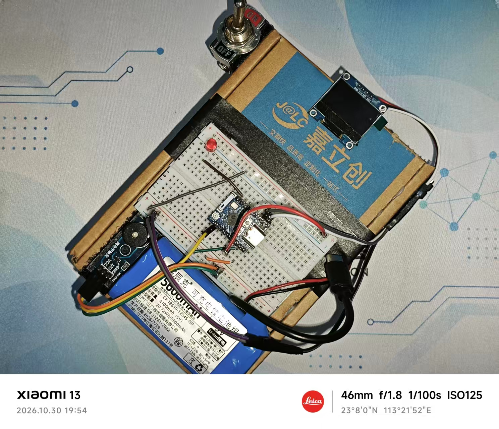

# Bomb —— 一个反恐精英风格的C4炸药小玩具

[[English](./README.md)] [中文]

> [!Note]
> 该项目用于个人学习和ESP32编程练习，所以它有些简陋和不完整。后续会慢慢补充

## 物料清单

- 嘉立创盒子（或其他合适的盒状物做基底）
- KL-B101 两脚两档开关（C4开关）
- 400孔面包板
- ESP32C3核心板
- SSD1306驱动的OLED模块（图中为0.96英寸大小）
- 有源蜂鸣器
- 18650电池组（Type-C输出）
- 绝缘胶布
- 魔术贴/双面胶
- 热熔胶（按需）
- 杜邦线若干

## 开发环境需求

- ESP-IDF v6.0.1+
- CMake 3.22+
- Python3 + pip3
